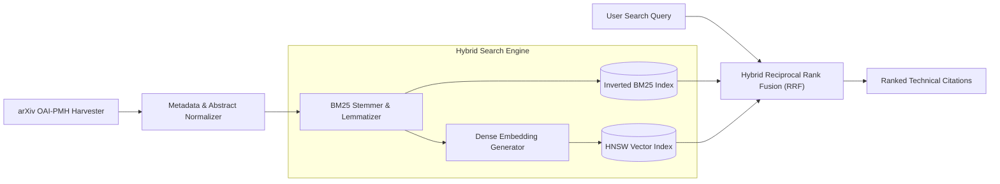

# 🔍 Search Engine Elite // Information Retrieval Architecture

> [!NOTE]
> **PROPRIETARY ARCHITECTURE // SOURCE UNDER NON-DISCLOSURE AGREEMENT (NDA)**  
> This repository serves as the public technical documentation and architectural whitepaper for the Search Engine 2.0 and arXiv scientific indexing ecosystem. Full source code is maintained in a private production repository.

---

## 🏛️ Ingestion & Indexing Pipeline Topology

---

## 🛠️ Technical Specifications & Algorithms

- **Corpus Target:** 117,000+ scientific preprints and technical publications from arXiv and open access repositories
- **Ranking Function:** Hybrid RRF (Reciprocal Rank Fusion) combining dense vector similarity with sparse BM25 token frequencies
- **Indexing Structure:** Memory-mapped inverted posting lists with delta-encoding compression
- **Query Latency:** Sub-80ms median response time for boolean and vector similarity queries

---

## 📑 System Design Overview

1. **Crawler Resiliency:** Implements exponential backoff rate-limiting adhering strictly to arXiv API terms of service.
2. **Deduplication:** MinHash LSH (Locality-Sensitive Hashing) applied to preprint versions to eliminate duplicate index entries.
3. **Continuous Deployment:** Containerized microservice deployable with isolated worker pods.

---
*Maintained by [Danyal Aqeel](https://github.com/DANYALAQEEL) // Systems & Search Architecture*
