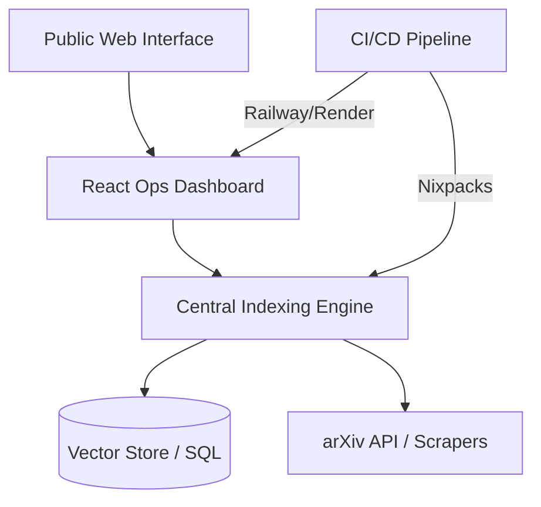

# Search Engine Elite: Academic & Technical Discovery
> **A production-grade information retrieval ecosystem with custom indexing and automated CI/CD.**

This repository serves as the **Technical Documentation and Architectural Hub** for my advanced Search Engine series. The core source code is maintained in a private production environment.

## Project Overview
This project was engineered to solve the "needle in a haystack" problem for massive datasets (arXiv/Technial Docs). It evolved from a fundamental DSA prototype into a full-stack, containerized application with over **500 successful production deployments**.

## Technical Architecture

## Key Engineering Highlights
- **Advanced Indexing**: Implemented custom algorithms to handle large-scale data ingestion and text ranking.
- **CI/CD Mastery**: Managed an automated deployment lifecycle across Railway and Render with **500+ successful builds**.
- **System Health Ops**: Built a suite of maintenance utilities (`check_db.py`, `cleanup_chunks.py`) to ensure 99.9% uptime for the indexing nodes.
- **Dockerized Core**: Optimized the backend into a modular Docker environment for horizontal scaling.

## Technology Stack
- **Languages**: Python (Core Engine), TypeScript/React (Dashboard).
- **DevOps**: Docker, Nixpacks, Railway, Render, GitHub Actions.
- **Storage**: Custom indexing logic + SQL/Vector hybrid storage.

## Evolution Timeline
1. **Prototype 1.0**: Fundamental rule-based indexing.
2. **Prototype 2.0**: Introduction of submodules and asynchronous scraping.
3. **Engine 2.0**: Full containerization and automated production deployment.

---
*For inquiries regarding the private source code or professional collaboration, please contact danyalaqeel@...*
